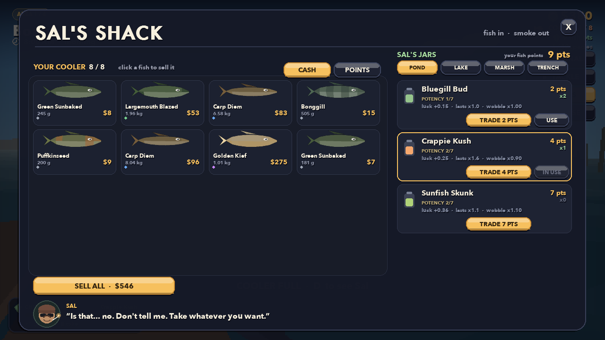
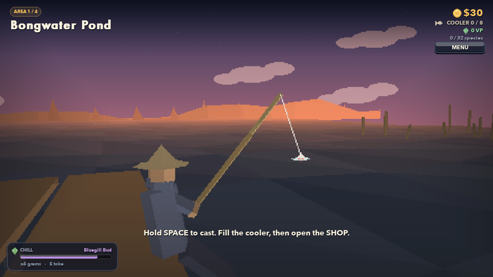

# Catch & Chill

**A stoned fishing collect-a-thon.** You are a fisherman at the most fished water
in the county. Fill your cooler, haul it to Sal's shack, and trade your catch for
cash — or for weed. Better fish buy better weed, better weed catches better fish,
and the journal fills up in the meantime. The 32 fish are real species, with real
sizes, colours and market rates.

Pure Python + pygame, no image or audio assets: every fish, wave and sound is
generated in code at startup, and the whole scene is software-rendered low-poly 3D.


---

## Play it

```bash
./run.sh
```

That's it. On first run the script creates a local virtualenv, installs
`pygame-ce` and `numpy`, then launches the game. (The `.venv` already in this
folder is reused if present — delete it any time and `run.sh` will rebuild it.)

Manual route, if you prefer:

```bash
python3 -m venv .venv
source .venv/bin/activate
pip install -r requirements.txt
python main.py
```

Requires Python 3.9+ on macOS, Linux or Windows.

---

## Controls

| Key | Action |
|---|---|
| **SPACE** | Cast (hold to build power) / set the hook / reel (hold) |
| **E** | Toke — smoke one gram of whatever is loaded |
| **D** | Sal's shack — sell fish, trade fish, buy weed |
| **J** | Field journal (the collection screen) |
| **B** | Tackle shop (rods, lines, lures, coolers, travel) |
| **ESC** | Pause |
| **`** | Developer console |
| **M** | Mute |
| **F11** | Fullscreen |

Mouse works everywhere in the menus. Left click also casts and reels.

---

## The loop

1. **Fish.** Hold SPACE to cast, tap on the bite, then hold to reel — keep the
   needle inside the moving gold band or the line snaps.
2. **Fill the cooler.** Every fish goes in the cooler instead of selling itself.
   When it is full you cannot cast any more. Bigger coolers are in the tackle
   shop; more water is unlocked with a journal and a travel fee.
3. **Go see Sal (D).** He is the only buyer. Click a fish to sell it, or switch
   to POINTS and click to trade it for Vibe Points (VP). Sell for cash (gear, coolers,
   travel) or trade for points (weed). Your choice, per fish.
4. **Buy weed with points.** Sal only opens the good jars for good fish: bring
   him a **rare** and he will sell you Deep Indica, a **legendary** opens Golden
   Hybrid, a **mythic** opens Cosmic Kush. Once he has seen one, he remembers —
   the jar stays open forever.
5. **Smoke it (E).** Being high pulls rarer fish and widens the bite window, at
   the cost of a wobblier needle. Rarer fish means better jars, and better jars
   mean rarer fish. One gram per toke; when the jar is empty, back to Sal.



## How to fish

1. **Cast.** Hold SPACE to swing the power meter, release to cast. More power =
   further out = deeper water = better fish.
2. **Wait.** The float bobs. A nibble is a fake-out. A real bite dunks the float
   and pops a **!** — tap SPACE while it is up. The window is longer while high.
3. **Reel.** Hold SPACE to reel in, let go to give slack. Keep the white needle
   inside the gold band to fill the fish's stamina bar. Sit at the top of the bar
   too long and the line snaps.
4. **Log it.** First catches pay a finder's fee and fill a journal slot. Some
   fish only bite at night, some only when you are high; the journal hints at who
   wants what.

## The chill

- Weed comes from Sal only. **Fish points** are earned by trading fish and spent
  on grams; **cash** is earned by selling the same fish and spent on gear.
- Each jar is gated by the rarest fish Sal has handled: uncommon → Sunset Sativa,
  rare → Deep Indica, legendary → Golden Hybrid, mythic → Cosmic Kush. Homegrown
  is always in stock.
- **Sunset Sativa** lasts a long time. **Deep Indica** hits harder (and shakes
  harder). **Golden Hybrid** pays better while high. **Cosmic Kush** is what the
  mythics are interested in.
- Smoke again while already very high and you get **COUCH LOCK** for a few
  seconds. Pace yourself.
- One gram = one toke. The HUD shows what is loaded and how much is left; "out of
  weed" means back to Sal.

## The fish

Thirty-two real North American freshwater species across four waters. The journal
records the binomial and your best weight for each one.

### Duckweed Pond

| Fish | Rarity | Size | Market |
|---|---|---|---|
| Bluegill | common | 80 g – 550 g | $3.6/kg |
| Pumpkinseed | common | 50 g – 300 g | $4/kg |
| Green Sunfish | common | 80 g – 450 g | $3.2/kg |
| Yellow Bullhead | uncommon | 200 g – 1.4 kg | $3.8/kg |
| Largemouth Bass | uncommon | 400 g – 3.0 kg | $4.6/kg |
| Common Carp | rare | 1.5 kg – 9.0 kg | $2.2/kg |
| Flathead Catfish | legendary | 4.0 kg – 20.0 kg | $6/kg |
| Golden Koi | mythic | 1.0 kg – 5.0 kg | $45/kg |

### Willow Lake

| Fish | Rarity | Size | Market |
|---|---|---|---|
| Yellow Perch | common | 100 g – 550 g | $8/kg |
| Black Crappie | common | 150 g – 800 g | $9/kg |
| Rainbow Trout | uncommon | 400 g – 2.8 kg | $12/kg |
| Smallmouth Bass | uncommon | 400 g – 2.4 kg | $9.5/kg |
| Northern Pike | rare | 1.0 kg – 7.0 kg | $7.5/kg |
| Walleye | rare | 500 g – 4.0 kg | $15/kg |
| Muskellunge | legendary | 4.0 kg – 16.0 kg | $8/kg |
| Golden Rainbow Trout | mythic | 500 g – 2.5 kg | $45/kg |

### Misty Marsh

| Fish | Rarity | Size | Market |
|---|---|---|---|
| Bowfin | common | 500 g – 3.0 kg | $4/kg |
| Brown Bullhead | common | 200 g – 1.6 kg | $4.2/kg |
| Longnose Gar | uncommon | 800 g – 4.0 kg | $5/kg |
| American Eel | uncommon | 300 g – 1.8 kg | $16/kg |
| Blue Catfish | rare | 2.0 kg – 12.0 kg | $4.8/kg |
| Northern Snakehead | rare | 800 g – 4.0 kg | $8.5/kg |
| Alligator Gar | legendary | 6.0 kg – 28.0 kg | $5.5/kg |
| Paddlefish | mythic | 5.0 kg – 20.0 kg | $12/kg |

### Moonlit Trench

| Fish | Rarity | Size | Market |
|---|---|---|---|
| Cisco | common | 150 g – 700 g | $7/kg |
| Burbot | common | 500 g – 3.5 kg | $10/kg |
| Lake Whitefish | uncommon | 500 g – 2.4 kg | $9/kg |
| Deepwater Sculpin | uncommon | 30 g – 200 g | $8/kg |
| Brook Trout | rare | 300 g – 1.6 kg | $14/kg |
| Sauger | rare | 400 g – 2.0 kg | $12/kg |
| Lake Trout | legendary | 3.0 kg – 12.0 kg | $12/kg |
| Lake Sturgeon | mythic | 8.0 kg – 35.0 kg | $22/kg |


**How the numbers work.** *Size* is the realistic catch range for that species
(records go bigger; the game's rolls skew small). *Market* is an approximate
wholesale/retail rate per kilogram. What Sal pays is weight × that rate with a
rarity premium, softened by an exponent and capped per rarity — so a bluegill is
worth pocket change and a 35 kg sturgeon is a genuine jackpot.

**Rarity** is a game stat, not a conservation status: it tracks how often you
would actually catch the thing and how much anglers prize it. That is why
walleye and pike sit at "rare" while bluegill is "common".

## The look

PS2-era, on purpose: everything is real flat-shaded 3D geometry run through a
small software renderer (`render3d.py`) — no z-buffer, just painter-sorted
polygons, one directional light and distance fog. The scene draws into a
640×360 buffer that is upscaled with nearest-neighbour and a light scanline
overlay, so facets stay chunky and edges stay aliased.

- **World**: an over-the-shoulder camera behind the angler, a low-poly dock, rod,
  float, ridge and tree line over a 16×14 wave grid that re-facets every frame.
- **The cast** is one continuous curve: the rod loads back while you charge, whips
  forward on release, and the float arcs out to the splash point.
- **Fish**: each species is a generated low-poly mesh (rings along the body,
  tail, dorsal, snout for the gar and paddlefish) rendered once and cached, so
  the journal matches the water.
- **UI** stays at full resolution and crisp on top — the menus are legible while
  the world is chunky.
- Roughly 9 ms/frame at 1280×720, so it still sits comfortably at 60 fps.

## Sources & numbers

Sizes, colouration and habitat follow the standard species references; market
values are approximate US wholesale/retail rates converted to $/kg. The four
mythic slots are genuine oddities: an escaped ornamental koi, a hatchery golden
trout, a paddlefish, and a lake sturgeon.

[Bluegill (Wikipedia)](https://en.wikipedia.org/wiki/Bluegill) ·
[FishBase](https://www.fishbase.se/) ·
[Tridge frozen trout market overview](https://www.tridge.com/market-overview/frozen-trout/US) ·
[Michigan DNR commercial harvest](https://www.michigan.gov/dnr/-/media/Project/Websites/dnr/Documents/Fisheries/Commercial/2025-Commercial-Harvest-Totals-For-the-Web.pdf) ·
[FishBrain sunfish ID guide](https://fishbrain.com/blog/fishbrains-guide-to-sunfish/fishbrain-guide-to-sunfish)

## Progression

- **4 waters** — Duckweed Pond (the famous one), Willow Lake, Misty Marsh,
  Moonlit Trench — unlocked with enough species and a travel fee.
- **32 species** across five rarities (see the tables above).
- **Gear**: 4 rods (reel speed, power, tolerance), 3 lines (how long you get
  before a snap), 5 lures (which rarity bites and how big), 3 coolers (8 / 12 / 16
  fish), and **12 strains of weed** — three per water, from potency 1 (Pond
  Homegrown) up to 7 (Cosmic Kush in the Trench). Each area's jars open by
  unlocking that water and showing Sal a fish of the required rarity.
- A full in-game day is about 3.6 real minutes. Night pays better for the good
  stuff, and some fish only show up after dark.



---

## Project layout

```
main.py                 entry point
run.sh                  one-command launcher (creates .venv on first run)
requirements.txt        pygame-ce, numpy
game/
  app.py                window, screen stack, main loop, save handling
  config.py             tuning constants, palette, time-of-day grading
  data.py               content: 32 real fish, 4 spots, gear, coolers, 5 strains
  player.py             cooler, cash, Vibe Points (VP), weed stash, save/load
  render3d.py           tiny painter-sorted polygon renderer (camera, meshes, fog)
  world3d.py            the low-poly lake: sky, water grid, dock, angler, rod
  fish3d.py             procedural low-poly fish meshes, cached per species
  world.py              legacy 2D scene renderer (unused)
  fishing.py            cast/bite/reel state machine + the tension minigame
  ui.py                 buttons, chips, icons, and the procedural fish art
  util.py               maths, fonts, panels, particles
  audio.py              every sound and the ambient pad, synthesised with numpy
  screens/              title, play, dealer (Sal), journal, shop, pause + help
tools/                  headless QA scripts (see below)
```

Save data lives next to the game in `save.json` (delete it to reset).

## Developer console

Press **`** (backtick) at any time. Type `help` for the list.

```
cash 5000        pts 200          addcash 500
unlock all       unlock spots     unlock gear      unlock jars
weed all 9       species all      bag fill         cooler huge
goto 4           time 22          chill 90         toke
instacatch on    nolinesnap on    debug on         wire on
save             reset            quit
```

- `unlock all` opens every water, owns and equips every rod/line/lure, and sets the
  cooler to 16 slots.
- `species all` fills the journal without touching the cooler; `bag fill` stocks the
  cooler with fish from the current water.
- `instacatch` / `nolinesnap` make the reel trivial (useful for testing later spots).
- `wire on` switches the 3D world to wireframe, `debug on` overlays fps, state and
  angler internals.
- TAB completes commands, UP recalls history.

## QA scripts

These run without a window (`SDL_VIDEODRIVER=dummy`), so they're handy for
tweaking numbers:

```bash
python tools/smoke.py        # full UI pass: catch -> cooler -> Sal -> shop -> save
python tools/soak.py         # 24 simulated minutes: economy, weed loop, crashes
python tools/reel_sim.py     # win rate / fight length per rod + fish difficulty
python tools/perf.py         # frame-time benchmark
python tools/shots.py play   # render a screenshot to /tmp
python tools/fishsheet.py    # contact sheet of all 32 fish
```

---

## Notes

- This is a fictional, comedic game about an adult activity. No real-world
  instructions of any kind.
- The cannabis mechanic is deliberately risk/reward: luck and a wider bite window
  against a wobblier needle and couch lock.
- Everything is drawn and synthesised at runtime; there are no asset files to
  lose.
